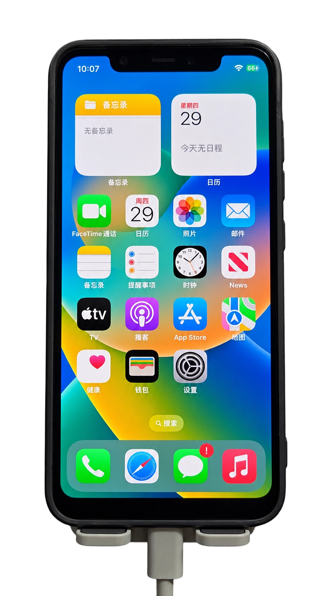

# dipper-xnu

**Experimental / Work in Progress**

面向 `dipper`（SDM845）的 XNU 与移动用户空间实验性移植项目。

基于 [HackiOS](https://github.com/oosexgang/hackios-xnu-kernel) 的工作，为 `dipper` 适配启动、显示、触摸、A630 GPU 和 WCN3990 Wi-Fi。支持 SpringBoard 桌面、GPU 渲染、触摸及 Wi-Fi 上网。

项目仍在开发中，尚不适合作为日常使用系统。

<p align="center">
  
  <br>
  <sub>小米 8 · iOS 16.5 · 实机运行照片</sub>
</p>

## 近期更新 · 2026-10-31

已走通本机“恢复 Android 布局 → 重新划出约 24 GiB darwin → 系统镜像回读 → 匹配新 GUID、重建 loader/UEFI → 进入 iOS”的流程，持有人确认启动成功。

- 分区前后均完成 Format Data、Android 启动和数据容量验收；系统镜像准确范围回读 SHA256 与主机一致。
- 教程整理为[分区、写入与回退](docs/install/INSTALL.md)和[配置、重建与启动](docs/install/STARTUP.md)，Android 恢复作为回退章节保留。
- **工具目录整理**：11 个脚本归入 `tools/prepare/`、`build/`、`partition/`、`tests/`，脚本引用与教程命令已同步，31 项回归测试通过。后续按[工具导航](tools/README.md)使用新路径。
- 本轮逐项外设回归与退出后重启 Android 仍待验；先前 Wi-Fi、亮度等测试结果单独保留，不视作本轮复测。

完整变化见 [更新日志](CHANGELOG.md)，阶段与证据见[首次安装任务](docs/development/FIRST_INSTALL.md)。

## 设备与系统

| 项目 | 配置 |
| --- | --- |
| 设备代号 | `dipper` |
| SoC | SDM845 |
| GPU | A630 |
| Wi-Fi | WCN3990 |
| 内核 | XNU 8796.121.2 |
| 用户空间 | iOS 16.5 |

启动流程：

```text
dipper 启动固件 → edk2-sdm845 UEFI → xnuloader → XNU → iOS 用户空间
```

## 功能状态

当前状态（2026-10-31）。已有分区的短时外设测试与本次重新分区后的 iOS 启动均有记录；下表外设结果来自此前测试，本轮完整回归、退出收尾和长期稳定性仍待验。

| 功能 | 状态 |
| --- | --- |
| 系统启动 | 已进入 SpringBoard 桌面 |
| 显示与 GPU | Mesa / freedreno 驱动 A630；卡顿与功耗仍待改善 |
| 触摸 | 已可用 |
| 屏幕亮度与锁屏 | 设置及控制中心调光、锁屏与唤醒可用 |
| 音量键 | 按键与音量条已可用，不代表音频输出可用 |
| 手电筒与振动 | 手电筒开关和振动可用；手电筒分档亮度不明显 |
| 电量显示 | 已可用 |
| Wi-Fi | 已能在设置中入网并获取 IP；状态栏图标仍为临时实现 |
| Safari | 已通过 Wi-Fi 打开并刷新网页 |
| 电话与移动数据 | 尚未验证可用 |
| 音频 | 尚未实现完整支持 |

详细进度与限制见 [功能状态](docs/STATUS.md)。

## 构建与安装

构建使用 **Linux x86_64**，开发环境为 **Ubuntu 26.04.1 LTS**。本仓库通过固定上游版本和 dipper 适配补丁组织源码。

1. [构建教程](docs/build/BUILD.md)与[输入材料](docs/build/INPUTS.md)：固定来源、校验、编译内核和 UEFI。
2. [用户空间与打包](docs/build/USERLAND.md)：提取 IPSW、编译适配程序、生成启动卷和系统镜像。
3. [分区、写入与回退](docs/install/INSTALL.md)：备份、分区、格式化、系统镜像回读与恢复 Android。
4. [配置、重建与启动](docs/install/STARTUP.md)：匹配新 GUID、重建 loader/UEFI、打包和日常 RAM 启动；[外设测试参考](docs/install/EXISTING_INSTALL.md)。

工具入口按用途分类，命令均从仓库根目录执行：

| 目录 | 用途 |
| --- | --- |
| `tools/prepare/` | 固定源码准备、SDK 校验、IPSW 提取 |
| `tools/build/` | 编译加载器、UEFI、用户态，打包镜像与载荷 |
| `tools/partition/` | 分区及 Android 恢复方案生成、回读核验 |
| `tools/tests/` | 主机回归测试 |

完整脚本清单见[工具导航](tools/README.md)。旧实验记录保留当时路径，后续运行请使用当前教程的新路径。

**首次安装需要划出独立的 `darwin` 分区，会清空 Android 用户数据。** 系统持久写入该分区，之后通过临时加载 UEFI 启动。

仓库仅提供源码、补丁和构建工具。系统镜像、专有 SDK、设备固件与备份需自行合法获取。构建及实机测试的详细依据见 [验证记录](docs/validation/VALIDATION.md)。

## 已知问题

- 桌面仍有卡顿，动态调频、功耗和长期稳定性尚待完善。
- 部分系统服务和应用功能不完整，不能将 Safari 可用理解为所有联网功能正常。
- GPU SMMU 和基带的退出恢复仍有问题，实验之间可能需要完整重启设备。
- 存储配置仍来自特定实验布局，不能直接套用到其他设备。本仓库已移除开发设备的分区唯一 GUID，尚不提供通用安装或一键刷机流程。

设备操作前应准备可靠的备份和恢复方案。请先阅读安装教程中的设备配置限制，不要直接使用历史分区参数。

## 参与开发

欢迎提交问题、源码改进和可复现的测试结果。提交时请注明设备、源码版本和测试方法，并区分主机测试与实机结果。

开发过程与 AI 接手入口见[开发流程与现场交接](docs/development/DEVELOPMENT.md)，每轮证据沿用 `work/runs/`，不另复制源码树。

详见 [贡献指南](CONTRIBUTING.md)。请勿在 Issue 或补丁中附带个人数据、设备备份或专有固件。

## 致谢

本项目建立在多个开源项目的工作之上，特别感谢：

- **OOSEX GANG / HackiOS**：XNU 移植基础、加载器、用户空间适配及无线兼容层。
- **Apple 开源项目**：XNU 与相关开放源码。
- **edk2-porting / Renegade Project、TianoCore、SimpleInit**：SDM845 的 UEFI 与启动支持。
- **UniXNU / DarwinBoot**：启动组件与早期移植参考。
- **Linux、Mesa / freedreno、FreeBSD**：硬件驱动、图形与兼容层基础。
- **Theos、LLVM 及相关工具链项目**：构建工具。

完整说明见 [致谢](ACKNOWLEDGEMENTS.md) 与 [第三方来源](THIRD_PARTY_NOTICES.md)。

## 许可证

各部分代码遵循其对应许可证，第三方版权声明予以保留。本项目并非整体采用单一 MIT 许可证；具体适用范围见 [许可说明](LICENSE.md) 和 [LICENSES](LICENSES)。其他文件的许可范围见 [许可证说明](docs/legal/LICENSE_REVIEW.md)。

本项目为独立研究项目，与设备厂商、系统厂商及所参考项目不存在官方隶属关系。

全部文档按用途分类，见 [文档导航](docs/README.md)。
