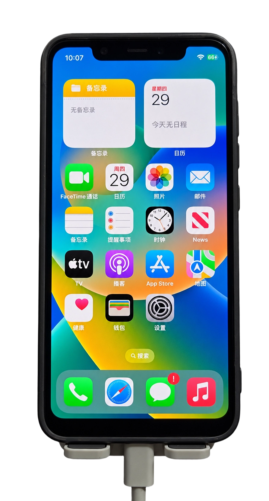

# dipper-xnu

**Experimental / Work in Progress**

面向 `dipper`（SDM845）的 XNU 与移动用户空间实验性移植项目。

基于 [HackiOS](https://github.com/oosexgang/hackios-xnu-kernel) 的工作，为 `dipper` 适配启动、显示、触摸、A630 GPU、WCN3990 Wi-Fi、蓝牙和扬声器音频。支持 SpringBoard 桌面、GPU 渲染、触摸、Wi-Fi 上网、蓝牙连接和扬声器声音。

项目仍在开发中，尚不适合作为日常使用系统。

<p align="center">
  
  <br>
  <sub>小米 8 · iOS 16.5 · 实机运行照片</sub>
</p>

## 近期更新 · 2026-11-12

- **扬声器有声音了**：iOS 的铃声、键盘音、视频等声音从小米 8 的扬声器播放出来，音量由 iOS 音量条调节。点击后约 40 ms 出声，开头渐入、结尾渐出，没有“啪”声。0 dB 连续播放 10 分钟，功放健康检查全过，CPU 41–43 °C。
- **怎么做到的**：内核接住 iOS 音频服务送来的 PCM，经高通音频 DSP（ADSP）的 ASM/ADM/AFE 通路从 QUAT MI2S 输出，再由内核直接驱动 TAS2557 功放（下载厂商固件、上电、健康检查、静音与软关断）；没有声音时功放自动断电，死机时功放立即断电。
- **蓝牙、扬声器、电量、震动、手电缺省开启**：打包只需 `--wifi`，不再需要 `--bluetooth`、`--peripherals` 或音频参数；需要关闭时追加 `bt=0`、`audio=0` 等。持有人无参数试用，这些功能都正常，开机不会自动播放。
- **还不行的**：开机约 1 分钟、Wi-Fi 就绪后才有声音；音质未调校；蓝牙耳机声音、麦克风和通话没有；音量键提示显示“声音关闭”；浏览器有时打不开网页（含刚开机时），原因未定；长时间运行的功耗未测。
- **需要自备**：TAS2557 功放固件需从自己的手机取出（ADSP 固件由内核直接从手机分区读取），见[配置、重建与启动](docs/install/STARTUP.md#扬声器电量震动与手电缺省开启)。
- 以上设备结果来自持有人的手动使用和设备日志，不是完整回归；细节见[更新日志](CHANGELOG.md)和[验证记录](docs/validation/VALIDATION.md)。

更早的更新见[更新日志](CHANGELOG.md)。

## 设备与系统

| 项目 | 配置 |
| --- | --- |
| 设备代号 | `dipper` |
| SoC | SDM845 |
| GPU | A630 |
| Wi-Fi | WCN3990 |
| 内核 | XNU 8796.121.2 |
| 用户空间 | iOS 16.5 |

启动流程：

```text
dipper 启动固件 → edk2-sdm845 UEFI → xnuloader → XNU → iOS 用户空间
```

## 功能状态

当前状态（2026-11-12）。已有分区的短时外设测试与重新分区后的 iOS 启动均有记录；下表外设结果大多来自重新分区之前的测试，蓝牙、扬声器、降低分辨率等较新的项目单独在近期更新里说明；重新分区后的完整回归、退出收尾和长期稳定性仍待验。

| 功能 | 状态 |
| --- | --- |
| 系统启动 | 已进入 SpringBoard 桌面 |
| 显示与 GPU | Mesa / freedreno 驱动 A630；卡顿与功耗仍待改善 |
| 触摸 | 已可用 |
| 屏幕亮度与锁屏 | 设置及控制中心调光、锁屏与唤醒可用 |
| 音量键 | 按键与音量条可用；按键提示显示“声音关闭”（待修） |
| 手电筒与振动 | 手电筒开关和振动可用；手电筒分档亮度不明显 |
| 电量显示 | 已可用 |
| Wi-Fi | 已能在设置中入网并获取 IP；状态栏图标仍为临时实现 |
| Safari | 已通过 Wi-Fi 打开并刷新网页；有时打不开网页，原因未定 |
| 蓝牙 | 缺省开启；可开关、搜索、配对，已连上耳机和另一部手机；耳机没有声音，配对不跨重启保存 |
| 降低渲染分辨率（可选） | 已能进桌面且更流畅；状态栏已修复，壁纸改为静态图；部分应用闪退，原因未定 |
| 静态壁纸 | 可用（自备图片）；设置里换壁纸无效 |
| 电话与移动数据 | 尚未验证可用 |
| 扬声器声音 | 缺省开启，iOS 声音从扬声器播放；音质未调校，功耗未测 |
| 蓝牙音频、麦克风、通话 | 尚未实现 |

详细进度与限制见 [功能状态](docs/STATUS.md)。

## 构建与安装

构建使用 **Linux x86_64**，开发环境为 **Ubuntu 26.04.1 LTS**。本仓库通过固定上游版本和 dipper 适配补丁组织源码。

开始前先看[设备版本、TWRP 与固件准备](docs/install/DEVICE_PREPARATION.md)，确认本机版本和输入来源。

1. [构建教程](docs/build/BUILD.md)与[输入材料](docs/build/INPUTS.md)：固定来源、校验、编译内核和 UEFI。
2. [用户空间与打包](docs/build/USERLAND.md)：提取 IPSW、编译适配程序、生成启动卷和系统镜像。
3. [分区、写入与回退](docs/install/INSTALL.md)：备份、分区、格式化、系统镜像回读与恢复 Android。
4. [配置、重建与启动](docs/install/STARTUP.md)：匹配新 GUID、重建 loader/UEFI、打包和日常 RAM 启动；[外设测试参考](docs/install/EXISTING_INSTALL.md)。

工具入口按用途分类，命令均从仓库根目录执行：

| 目录 | 用途 |
| --- | --- |
| `tools/prepare/` | 固定源码准备、SDK 校验、IPSW 提取 |
| `tools/build/` | 编译加载器、UEFI、用户态，打包镜像与载荷 |
| `tools/partition/` | 分区及 Android 恢复方案生成、回读核验 |
| `tools/tests/` | 主机回归测试 |

完整脚本清单见[工具导航](tools/README.md)。旧实验记录保留当时路径，后续运行请使用当前教程的新路径。

**首次安装需要划出独立的 `darwin` 分区，会清空 Android 用户数据。** 系统持久写入该分区，之后通过临时加载 UEFI 启动。

仓库仅提供源码、补丁和构建工具，**不提供预编译内核或系统镜像**：内核需在你自己的机器上编译（原因见 [GPU 许可说明](docs/legal/GPU_LICENSE.md#分发方式2026-10-31-起)）。系统镜像、专有 SDK、设备固件与备份需自行合法获取。构建及实机测试的详细依据见 [验证记录](docs/validation/VALIDATION.md)。

## 已知问题

- 桌面仍有卡顿（降低分辨率可缓解，但目前有应用闪退），动态调频、功耗和长期稳定性尚待完善。
- 蓝牙耳机听不到声音，配对记录重启后丢失，开机约 70 秒后才就绪；只测过一副耳机和一部手机。
- 扬声器开机约 1 分钟（Wi-Fi 就绪后）才有声音，音质未调校；音量键提示显示“声音关闭”；常驻音频的功耗与长时间运行未验收。
- 浏览器有时打不开网页（含刚开机时）：Wi-Fi 已连接但网络连接无响应，原因未定。
- 部分系统服务和应用功能不完整，不能将 Safari 可用理解为所有联网功能正常。
- GPU SMMU 和基带的退出恢复仍有问题，实验之间可能需要完整重启设备。
- 存储配置仍来自特定实验布局，不能直接套用到其他设备。本仓库已移除开发设备的分区唯一 GUID，尚不提供通用安装或一键刷机流程。

设备操作前应准备可靠的备份和恢复方案。请先阅读安装教程中的设备配置限制，不要直接使用历史分区参数。

## 参与开发

欢迎提交问题、源码改进和可复现的测试结果。提交时请注明设备、源码版本和测试方法，并区分主机测试与实机结果。

开发过程与 AI 接手入口见[开发流程与现场交接](docs/development/DEVELOPMENT.md)，每轮证据沿用 `work/runs/`，不另复制源码树。

详见 [贡献指南](CONTRIBUTING.md)。请勿在 Issue 或补丁中附带个人数据、设备备份或专有固件。

## 致谢

本项目建立在多个开源项目的工作之上，特别感谢：

- **OOSEX GANG / HackiOS**：XNU 移植基础、加载器、用户空间适配及无线兼容层。
- **Apple 开源项目**：XNU 与相关开放源码。
- **edk2-porting / Renegade Project、TianoCore、SimpleInit**：SDM845 的 UEFI 与启动支持。
- **UniXNU / DarwinBoot**：启动组件与早期移植参考。
- **Linux、Mesa / freedreno、FreeBSD**：硬件驱动、图形与兼容层基础。
- **[Team Win / TWRP 与 dipper 维护者](https://twrp.me/xiaomi/xiaomimi8.html)**：提供分区维护、格式化与镜像回读所用的 Recovery 环境。
- **Theos、LLVM 及相关工具链项目**：构建工具。

完整说明见 [致谢](ACKNOWLEDGEMENTS.md) 与 [第三方来源](THIRD_PARTY_NOTICES.md)。

## 许可证

各部分代码遵循其对应许可证，第三方版权声明予以保留。本项目并非整体采用单一 MIT 许可证；具体适用范围见 [许可说明](LICENSE.md) 和 [LICENSES](LICENSES)。其他文件的许可范围见 [许可证说明](docs/legal/LICENSE_REVIEW.md)。

本项目为独立研究项目，与设备厂商、系统厂商及所参考项目不存在官方隶属关系。

全部文档按用途分类，见 [文档导航](docs/README.md)。
